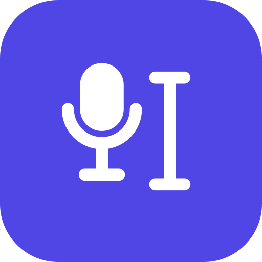

  

# Word for Word

Push-to-talk dictation for Android that types **your exact words** into any text box, with no AI rewording. Keep your normal keyboard: tap the floating mic button (or press a keyboard shortcut), speak, tap again, and the text appears at the cursor.

## Get the app

- **Google Play:** [Word for Word on Google Play](https://play.google.com/store/apps/details?id=com.isaacweber.wordforword) *(in testing — opens once approved)*
- **GitHub (APK):** Download **`WordForWord.apk`** from the [latest release](https://github.com/isaacweber613/whisper-verbatim/releases/latest) (Android 6+).
  - Needs your own [OpenRouter](https://openrouter.ai) API key. The app walks you through setup.
  - There is also a `WordForWordSelfUpdate.apk` build that installs updates in-app (Play Protect flags it; tap "Install anyway" if you prefer it).

## What it does

- **Types into any app** without replacing your keyboard. If an app blocks direct typing, the text is copied to your clipboard.
- **Pick your speech model** on OpenRouter — includes MAI-Transcribe 2, GPT Transcribe, Voxtral Mini, and Scribe v2, plus any custom OpenRouter speech-to-text model across ~60 languages.
- **Verbatim mode** (optional) keeps filler words and false starts; leave it off for cleaner transcripts.
- **Transcribe voice notes & videos** — share any audio or video file to Word for Word from another app.
- **Physical keyboard shortcut** — bind any key or key combo to dictate on keypad phones.
- **History** — tap any recent transcription to copy it again.

## Privacy & Accessibility

Word for Word uses Android's Accessibility service only to type dictated text into the focused box and watch for your optional keyboard shortcut. Audio goes from your phone to OpenRouter with no Word for Word server in between (optional Yiddish dictation uses a separate server). See [PRIVACY.md](PRIVACY.md) for the full policy.

---

Started as a fork of [kafkasl/phone-whisper](https://github.com/kafkasl/phone-whisper). Licensed under Apache 2.0 ([LICENSE](LICENSE)).
